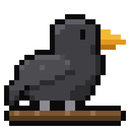
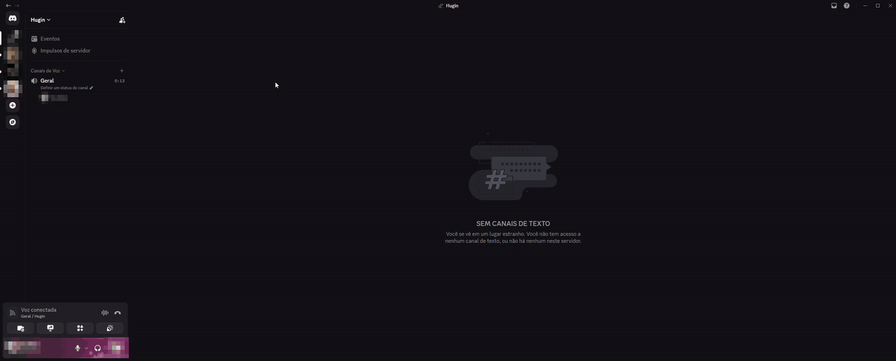

<p align="center">
  
</p>

<h1 align="center">Hugin</h1>

> *Antes que o sol toque Midgard, Odin solta seus dois corvos ao vento: **Hugin**, o Pensamento, e **Munin**, a Memória. Eles cruzam os nove reinos, rasgam tempestades e sobrevoam campos de batalha onde nenhum mortal ousa pisar. Quando a noite cai, retornam ao ombro do Pai de Todos e sussurram tudo o que seus olhos viram.*
>
> *Hoje, Hugin não voa só para Odin. Ele parte da sua tela, atravessa os céus sem pousar em servidor algum e entrega cada quadro, ao vivo, aos olhos de quem luta ao seu lado na call.*

Transmita sua tela ao vivo para os amigos que estão no mesmo servidor do Discord, em alta qualidade, com o vídeo indo direto do seu PC para o deles.

> Projeto iniciado por Leandro e continuado aqui.

<p align="center">
  
</p>

## O que ele faz

- **Compartilhamento de tela dentro do Discord.** O botão de compartilhar tela da call passa a abrir o Hugin, com a mesma aparência do Discord: escolha um aplicativo ou a tela inteira e pronto.
- **Direto entre os PCs.** O vídeo vai de um computador para o outro (P2P, via [VDO.Ninja](https://vdo.ninja)), sem passar pelos servidores do Discord.
- **Qualidade de verdade.** 480p, 720p, 1080p, 1440p ou a resolução original da tela, a 15, 30 ou 60 fps. Dá para trocar a qualidade no meio da transmissão sem derrubar ninguém.
- **Áudio sem eco.** Transmitindo uma janela, só o som daquele aplicativo vai junto. Transmitindo a tela inteira, vai todo o som do PC menos o do Discord: as vozes da call, os sons de entrar, sair e mutar e as transmissões que você está assistindo ficam de fora. Dá para ligar e desligar o áudio no ar.
- **Ao Vivo no servidor todo.** O selo "Ao Vivo" aparece em quem está transmitindo em qualquer call do servidor. Passe o mouse para ver a prévia e clique para entrar na call e assistir.
- **Assistir como no Discord.** Prévia junto dos cards de atividade, palco com tela cheia, zoom com minimapa, janela flutuante (PiP) quando você sai da tela da call e volume até 200%.
- **Link para assistir no celular.** Quem está transmitindo pode abrir o menu da transmissão, copiar um link ou preparar uma mensagem no chat para alguém assistir pelo navegador do celular via VDO.Ninja.
- **Sem configuração.** Quem entra no mesmo canal de voz com o Hugin cai automaticamente na mesma sala, protegida por senha derivada do canal.

> 


## Como usar

1. Baixe o `Hugin.exe` na [última release](https://github.com/rodrigoscode/Hugin/releases/latest).
2. Dê dois cliques. Ele fecha o Discord, instala e abre o Discord de novo.
3. Entre numa call de voz e clique no botão de compartilhar tela.
4. Seus amigos precisam ter o Hugin instalado também. Eles veem o "Ao Vivo" no seu nome e clicam para assistir.
5. Para alguém assistir no celular, abra o menu da transmissão e clique em **Assistir no celular**. O link abre no navegador e dá acesso direto à sua transmissão enquanto ela estiver ao vivo.

Quando o Discord se atualizar, o Hugin pode sair junto. Basta abrir o `Hugin.exe` de novo.

### Atualizações do Hugin

O Hugin consulta as releases estáveis de `rodrigoscode/Hugin` depois que o Discord carrega e, enquanto estiver aberto, a cada seis horas. A consulta usa a API pública do GitHub, sem enviar a sessão do Discord. O intervalo e o cache são preservados entre reinicializações.

Quando há uma versão nova com instalador verificável, a janela **Atualização disponível** abre diretamente com o ícone do Hugin, a versão e as notas da release, inclusive durante uma chamada. A instalação continua bloqueada até encerrar a chamada e a reprodução. Também é possível clicar com o botão direito no botão de compartilhar tela do Hugin e escolher **Verificar atualizações**.

- **Baixar atualização** baixa e verifica o instalador sem interromper a chamada.
- **Reiniciar e atualizar** exige uma nova confirmação sua e fica bloqueado durante chamada, transmissão, reprodução ou encerramento de players. Se o estado da chamada não puder ser confirmado, a instalação também fica bloqueada.
- **Depois** adia o aviso por 24 horas; **Ignorar esta versão** silencia aquela release. A consulta manual permite rever seus detalhes.
- A instalação solicita o encerramento normal do Discord, atualiza os canais instalados que já têm Hugin e reabre o canal de origem. Outros canais com Hugin precisam estar fechados; o atualizador não os encerra à força.

Downloads são conferidos por tamanho e SHA-256 usando o `checksums.txt` publicado com a release. Releases antigas sem esse arquivo continuam disponíveis para instalação manual pelo GitHub. O checksum verifica a integridade do download, não é uma assinatura do editor.

O payload anterior e os arquivos compartilhados são salvos antes da instalação e restaurados se houver uma falha. Se uma atualização for interrompida e o Discord não abrir, feche todos os clientes Discord e execute um `Hugin.exe` baixado da release: o instalador tenta recuperar o backup antes de reinstalar. Não apague a pasta `updates/recovery` antes dessa recuperação.

Se o Windows mostrar o aviso "O Windows protegeu o computador", clique em **Mais informações** e depois em **Executar assim mesmo**. O aviso aparece porque o executável não é assinado.

## Requisitos

- Windows 10 ou 11.
- Discord para desktop (Estável, PTB ou Canary).
- Para assistir dentro do Discord, todo mundo precisa do Hugin. No celular, basta abrir o link compartilhado no navegador.
- Para o áudio separado (só o aplicativo na janela, tudo menos o Discord na tela inteira), Windows 11. No Windows 10 a transmissão leva o som do PC inteiro, Discord incluído.

## Privacidade e riscos

- O vídeo e o áudio vão por WebRTC direto entre os participantes. A conexão é intermediada pelo VDO.Ninja, que ajuda os PCs a se encontrarem.
- O link de celular contém o acesso à sala da transmissão. Quem receber o link pode assistir enquanto ela estiver ao vivo; compartilhe só com quem deve entrar.
- Para mostrar o nome e a foto de quem está transmitindo, o Hugin lê as respostas que o próprio Discord já recebe e pode pedir perfis à API do Discord usando a sua sessão. Para desligar esses pedidos, coloque `"fetchOwnProfile": false` e `"fetchProfiles": false` no `config.json`.
- **Modificar o cliente do Discord vai contra os Termos de Serviço do Discord.** Use por sua conta e risco.

## Desinstalar

Abra um terminal na pasta do executável e rode:

```
Hugin.exe uninstall
```

Isso devolve o Discord ao original. Para apagar também as configurações e os logs, use `Hugin.exe uninstall --purge`.

## Arquivos

Tudo fica em `%APPDATA%\Hugin`:

| Arquivo | Para quê |
|---|---|
| `config.json` | Configurações. Pode ser editado com o Discord fechado. |
| `log.txt` | Log do Hugin dentro do Discord. É o arquivo para mandar quando algo der errado. |
| `install.log` | O que o instalador fez. |
| `updates/` | Cache de releases, preferências de aviso, instalador preparado e backup de uma atualização em andamento. |

## Opções do instalador

```
Hugin.exe                 instala (mesmo que dar dois cliques)
Hugin.exe status          mostra o estado, sem mudar nada
Hugin.exe uninstall       desinstala
Hugin.exe help            lista todas as opções
```

Algumas opções úteis: `--no-kill` (não fecha o Discord), `--no-launch` (não abre o Discord no final), `--branch=ptb` (escolhe a versão do Discord) e `--debug` (grava logs detalhados e abre a porta de depuração).

## Problemas comuns

- **Não aparece "Ao Vivo" para o meu amigo.** Ele precisa estar no mesmo servidor, com o Hugin instalado na versão mais recente.
- **A tela fica preta ao compartilhar o próprio Discord.** É o efeito de espelho infinito do Windows. Compartilhe outra janela ou a tela inteira.
- **No Windows 10 a transmissão fica perto de 30 fps com a janela coberta.** O Windows 10 limita a captura de janelas que não estão visíveis.
- **Fechei o aplicativo que estava transmitindo.** A transmissão termina sozinha, como no Discord.

### Copiar diagnóstico de uma sessão

Se encontrar um problema, clique com o botão direito no botão de compartilhar tela do Hugin e escolha **Copiar diagnóstico**. Com o botão em foco, também é possível abrir esse menu com **Shift+F10** ou a tecla de menu de contexto. A ação funciona mesmo sem uma transmissão ativa e não abre o seletor de fontes.

A opção também aparece nos menus de gerenciamento da transmissão e de espectador. No PiP, clique com o botão direito no player. Aguarde a confirmação de cópia e cole o relatório na issue junto com os passos para reproduzir o problema.

O relatório contém versões, estado dos players, configurações solicitadas de captura e áudio, dados de tracks observados quando disponíveis e até 300 eventos recentes dos últimos 30 minutos. O histórico fica apenas na memória do processo e é perdido ao encerrar o Discord. São usados identificadores locais, sem nomes de janelas, IDs reais de usuários/canais/salas, senhas, tokens ou URLs de transmissão; o `log.txt` não é anexado.

A coleta não inicia uma captura nem altera a reprodução. Se alguma informação não puder ser obtida dentro do prazo, o relatório indica uma coleta parcial. Configuração solicitada e sinal de início de vídeo não comprovam entrega de áudio ou reprodução contínua. Os snapshots dos processos são coletados em momentos próximos, não de forma atômica; os eventos estão ordenados pelo recebimento, com o horário de origem para ajudar na correlação.

## Para desenvolvedores

Precisa de Go e Node.js. Na pasta do projeto:

```
.\build.ps1
```

O executável sai em `dist\Hugin.exe`.

### Testes e validação

Depois de gerar o payload com `go run ./tools/bundle`, execute:

```powershell
go test ./...
node --test tools/test-capture.cjs tools/test-diagnostics.cjs tools/test-updates.cjs
node tools/run-stage-tests.cjs
```

Os testes de navegador usam o Microsoft Edge em modo headless. Se estiver instalado em outro local, defina `HUGIN_TEST_BROWSER` com o caminho do executável. Eles verificam a integração com o DOM do Discord, o ciclo de vida dos players e os acessos e feedbacks do diagnóstico. Os testes Node verificam também os limites do histórico, os campos exportáveis, os remetentes IPC e a geração de relatórios parciais. A captura de mídia e o IPC são isolados; áudio e vídeo reais ainda precisam ser conferidos em uma call.

A CI e as releases usam o mesmo workflow de validação: testes Go, testes JavaScript e build com verificação de sintaxe e referências. A release publica o executável produzido por esse workflow, sem recompilá-lo na etapa de publicação.

Os testes de atualização usam respostas HTTP e processos isolados para verificar cache/ETag, versões, backoff do GitHub, download corrompido, recuperação, IPC, confirmação de chamada e interface. Eles não fecham seu Discord. Uma atualização real entre duas releases ainda deve ser conferida em Windows antes da distribuição.

A versão de referência está em `internal/version/version.go`; o bundler a injeta nos dois bundles JavaScript. Tags de release devem ser exatamente `v` seguido dessa versão, por exemplo `v1.0.11`. A CI rejeita divergências e gera `checksums.txt` a partir do executável validado. A publicação anexa ambos e gera notas de release quando necessário. Para publicar pelo workflow manual, selecione uma tag.

### Organização do código

- `internal/`: instalador, configuração e captura de áudio em Go.
- `src/main/`: integração com o processo principal do Electron, captura e janelas de mídia.
- `src/preload/`: comunicação entre os processos e adaptação da captura.
- `src/renderer/`: interface e integração com o Discord.
- `src/shared/diagnostics.js`: contratos, sanitização e histórico limitado dos eventos de diagnóstico.
- `src/main/core/diagnostics.js`: coleta de recursos nativos, geração do relatório e cópia.
- `src/renderer/core/diagnostics.js` e `src/renderer/ui/diagnostics.js`: eventos/snapshot de reprodução e interface do diagnóstico.
- `src/renderer/stage/stream-frame.js`: registro das sessões de reprodução e rotinas compartilhadas de retenção, transferência e encerramento dos players.
- `internal/updater/` e `internal/cli/update.go`: releases, download verificado, exclusão mútua e instalação com recuperação.
- `src/main/core/updates.js` e `src/renderer/ui/update-modal.js`: coordenação de atualização, proteção de chamadas e interface.
- `src/renderer/captures/`: markup e estilos capturados da interface do Discord.

Os arquivos `src/main/modules.txt` e `src/renderer/modules.txt` definem a ordem de concatenação dos módulos, que compartilham escopo dentro de cada bundle. Ao adicionar um módulo, inclua-o no manifesto correspondente e execute o build para conferir as referências.
